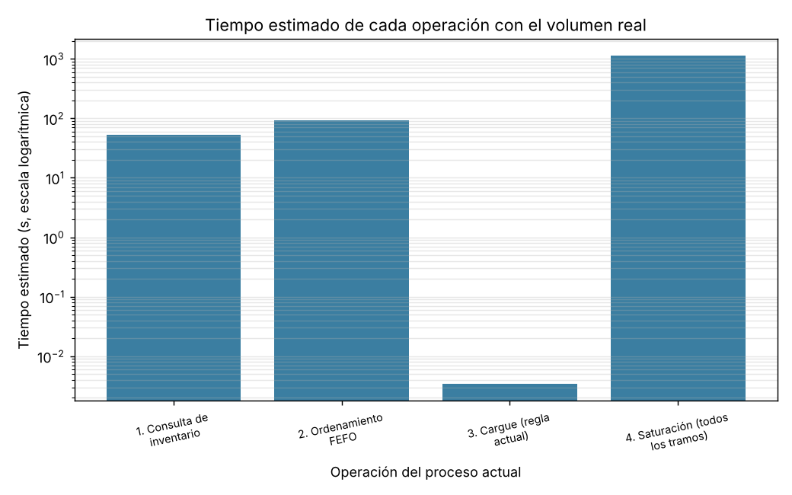
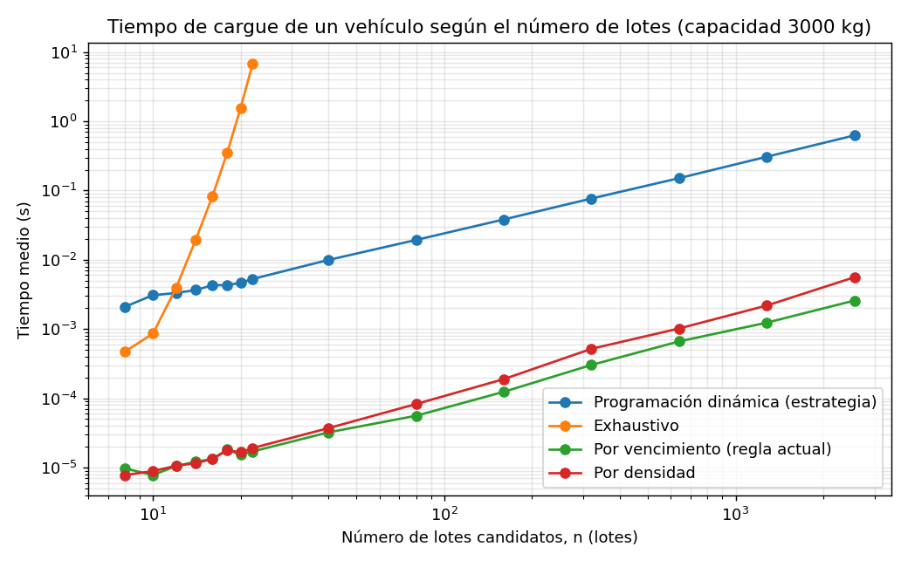
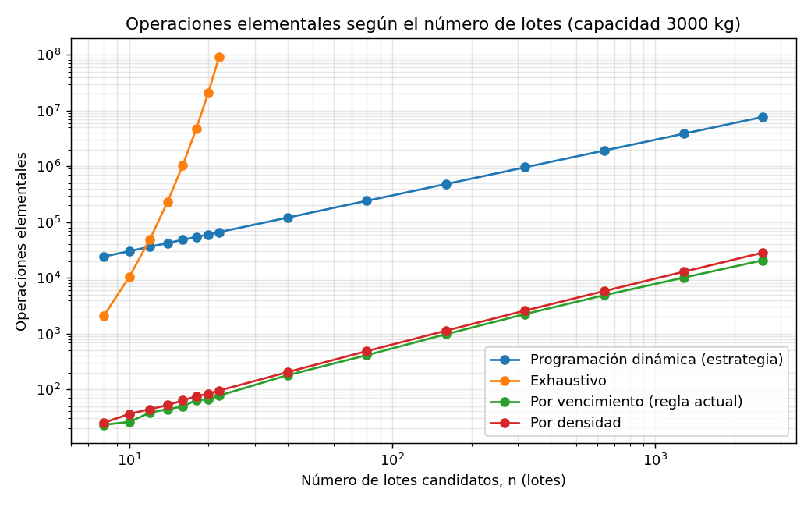
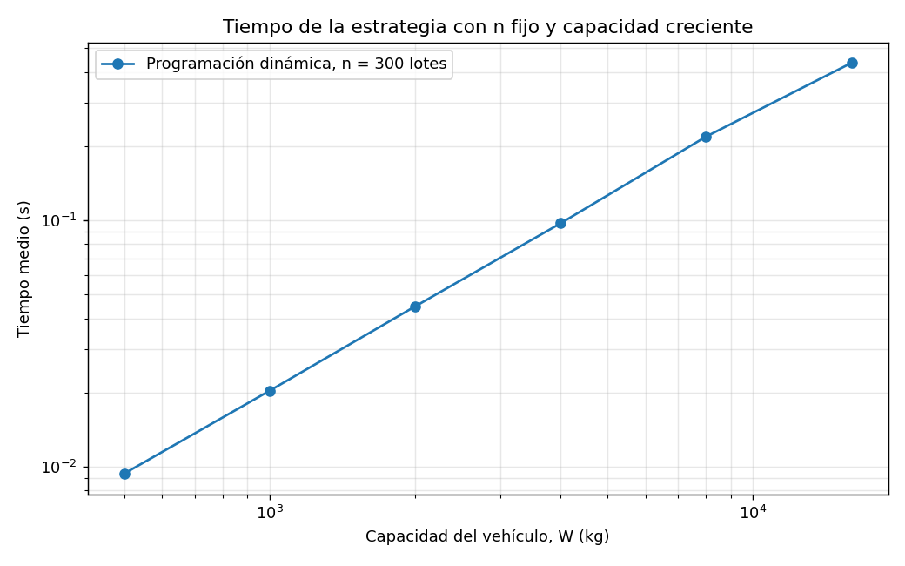
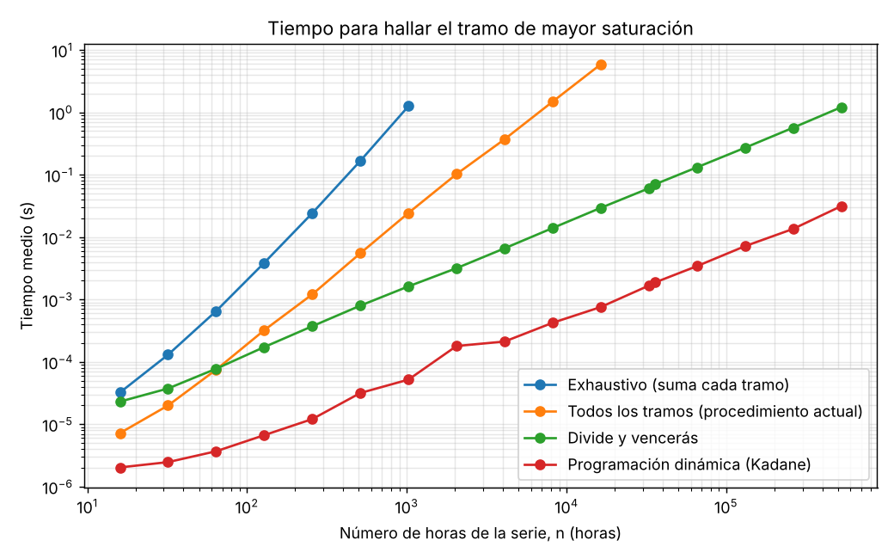
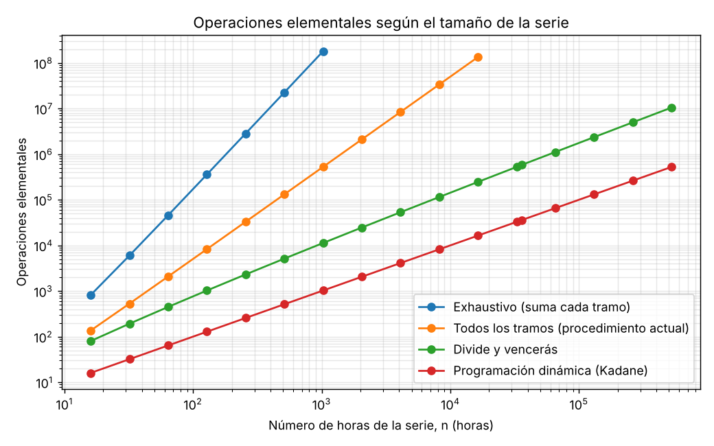

# Proyecto final — Análisis de algoritmos

## Caso 3: Banco Regional de Alimentos

- **Integrantes:** Laura Valentina Vargas Cortes, Álvaro Sotelo Galvis, Felipe Ramírez Loaiza y José Fernando Sepúlveda Chanci
- **Caso asignado:** Caso 3 — Banco de alimentos
- **Entregas:** Laboratorio 4 (operación 3) y proyecto final

En este informe analizamos el proceso de planeación de despachos del Banco Regional de Alimentos, que hoy no alcanza a terminar dentro de su ventana de 2 horas. Trabajamos a fondo dos de las cuatro operaciones críticas: la **operación 3 (cargue de los vehículos)**, que resolvimos con programación dinámica (mochila 0/1) y es la parte del Laboratorio 4, y la **operación 4 (análisis de saturación de la bodega)**, que resolvimos de dos formas: divide y vencerás y programación dinámica. De las operaciones 1 y 2 medimos cómo funcionan hoy para tener la línea base del proceso, pero no las implementamos.

Estructura del repositorio:

```
├── README.md                 # este informe
├── Informe_tecnico.pdf       # el mismo informe en PDF
├── requirements.txt
├── src/
│   ├── cargue_vehiculos/     # operación 3 (Laboratorio 4)
│   ├── saturacion_bodega/    # operación 4
│   └── linea_base/           # operaciones 1 y 2 tal como funcionan hoy
├── graficas/                 # una carpeta por operación
└── resultados/               # números de las mediciones (JSON)
```

---

## 1. Análisis del problema

### 1.1 Descripción del problema computacional

El banco recibe alimentos donados (muchos próximos a vencer) y los reparte a 420 organizaciones. Cada madrugada un proceso planea los despachos y hoy tarda cerca de 4 horas y media, cuando la ventana es de 2 horas (03:00 a 05:00). El resultado es que los vehículos salen tarde, las comidas llegan después de la hora de preparación y parte de los perecederos se vence en la bodega. Según la Dirección de Operaciones, el problema no es el computador sino las estrategias algorítmicas de las cuatro operaciones críticas.

### 1.2 Entradas, salidas y restricciones

| Operación | Entradas | Salida | Restricciones del negocio |
|---|---|---|---|
| 1. Consulta de inventario | ≈ 220.000 lotes activos; ≈ 30.000 consultas por código al día y consultas por rango de vencimiento | El lote con ese código, o los lotes que vencen en el rango | Consulta por lote en menos de 1 s; terminar en la ventana de 2 h |
| 2. Ordenamiento FEFO | Lista ordenada del día anterior más 6.000 a 9.000 lotes nuevos | Lotes ordenados por vencimiento y, a igual fecha, por categoría | Ningún lote vencido se despacha; dentro de una categoría sale primero el que vence primero |
| **3. Cargue de vehículos** | Para cada uno de los 14 vehículos: capacidad `W` (2.500 a 4.000 kg) y entre 300 y 600 lotes candidatos con peso entero (kg), valor nutricional y días para vencer | Los lotes que suben a cada vehículo | Ningún vehículo supera su capacidad; el valor es el **máximo**, no una aproximación; un lote no se fracciona |
| **4. Saturación de la bodega** | Para cada una de las 40 categorías, la serie de cambio neto de inventario por hora (kg, puede ser negativo); ≈ 36.000 horas por categoría | El tramo de horas consecutivas con mayor crecimiento acumulado | El tramo debe ser el de mayor crecimiento, no una aproximación |

Restricciones generales: el registro original de cada lote no se modifica (trazabilidad sanitaria) y hay un solo computador de escritorio, sin procesamiento paralelo.

### 1.3 Operaciones críticas y costo energético del proceso actual

Para saber cuáles operaciones pesan más, implementamos cómo funcionan hoy las operaciones 1, 2 y 4 (y la regla de cargue de la operación 3) en [`src/linea_base/procesos_actuales.py`](src/linea_base/procesos_actuales.py), [`src/cargue_vehiculos/regla_actual.py`](src/cargue_vehiculos/regla_actual.py) y [`src/saturacion_bodega/regla_actual.py`](src/saturacion_bodega/regla_actual.py). Medimos con datos sintéticos y extrapolamos al volumen real (los detalles del método están en la sección 4.3). La energía es `kWh = kW × h` con 150 W = 0,150 kW.

| Operación (como funciona hoy) | Tiempo estimado con el volumen real | Energía por ejecución |
|---|---|---|
| 1. Consulta de inventario (recorre la lista): 30.000 consultas por código + 40 por rango | 52,8 s por noche | 0,0022 kWh |
| 2. Ordenamiento FEFO por inserción (≈ 227.500 lotes) | 92,0 s por noche | 0,0038 kWh |
| 3. Cargue por vencimiento (14 vehículos) | 0,0034 s por noche | 1,4 × 10⁻⁷ kWh |
| 4. Saturación: evalúa todos los tramos (40 categorías × 36.000 horas) | 1.137 s (≈ 19 min) por corrida | 0,047 kWh |



*Figura 1. Tiempo estimado de cada operación del proceso actual con el volumen real (escala logarítmica). Fuente: [`src/linea_base/medicion.py`](src/linea_base/medicion.py).*

Hay dos cosas que queremos dejar claras sobre estos números:

1. **No logramos reproducir las 4,5 horas del cliente.** Sumando las operaciones 1 a 3, nuestras mediciones dan unos 145 s por noche. Esto lo atribuimos a que el software y el equipo del banco no son los nuestros (por ejemplo, el cliente también dice que la operación 4 tarda "más de un día", y nuestra extrapolación da 19 minutos, unas 76 veces menos). Por eso usamos nuestras mediciones solo para comparar operaciones entre sí, y para el costo energético total de la línea base usamos el tiempo que informa el cliente.
2. **Costo energético del proceso actual (dato del cliente):** 4,5 h × 0,150 kW = **0,675 kWh por noche**, es decir 0,675 × 300 días = **202,5 kWh al año**. Para la operación 4, que no es nocturna, el cliente reporta más de 24 h, o sea al menos 24 h × 0,150 kW = 3,6 kWh por corrida; suponiendo una corrida mensual (supuesto nuestro) serían 43,2 kWh al año.

Según nuestras mediciones, la operación que más cuesta en cómputo es la **4**, seguida de la 2 y la 1. La operación 3 es barata de calcular con la regla actual, pero es la que más desperdicio genera (los vehículos salen al 78 % de su capacidad). Por eso elegimos las operaciones **3** (es la del Laboratorio 4, obligatoria) y **4** (la de mayor costo computacional).

### 1.4 Supuestos

- Los datos del cliente son válidos y consistentes, no cambian durante la ejecución y caben en memoria; usamos un solo hilo.
- Los pesos de los lotes son enteros en kilogramos y mayores o iguales a 1; los valores nutricionales son enteros no negativos. Si se midieran en gramos el costo de la programación dinámica se multiplicaría (ver sección 6.4).
- Los lotes candidatos de la operación 3 no están vencidos: la validación de entrada rechaza lotes con días para vencer negativos, para respetar la restricción de que ningún lote vencido se despache.
- Cada vehículo sale una vez al día y se carga con una sola ruta.
- En la operación 4 un tramo debe tener al menos una hora; si todas las horas son negativas, el resultado es la hora menos mala.
- La operación 4 no tiene ventana propia en el caso. Tomamos como referencia las 2 horas de la ventana de planeación porque corre en el mismo computador.
- Supusimos que la operación 4 se ejecuta una vez al mes (12 corridas al año) y que en la operación 1 se hace una consulta por rango por cada una de las 40 categorías.
- El banco opera 300 días al año (dato del caso).
- Los datos sintéticos de la operación 3 se generan para que cargar por vencimiento llene en promedio cerca del 78 % que informa el cliente (en nuestros días simulados dio 79,6 %). La mitad de los lotes pesan entre 15 y 250 kg y la otra mitad entre 250 y 2.000 kg.

---

## 2. Diseño de la solución

### 2.1 Estructuras de datos seleccionadas

- **Operación 3:** cada lote es una tupla `(peso_kg, valor_nutricional, dias_para_vencer)` y los lotes van en una lista. La programación dinámica usa una **tabla** (lista de listas) de `(n + 1) × (W + 1)` enteros, y el resultado son los índices de los lotes elegidos.
- **Operación 4:** la serie es una lista de enteros y el resultado una tupla `(suma, hora_inicial, hora_final)`. Divide y vencerás trabaja con índices (`bajo`, `alto`) sobre la misma lista, sin copiar sublistas, para no pagar un costo extra por cada llamada; Kadane solo guarda dos números.
- **Operaciones 1 y 2 (solo propuesta, no implementada):** para buscar por código usaríamos una tabla hash (`dict`) de código a lote, con costo promedio constante por consulta; para los rangos de vencimiento, una lista ordenada por fecha con búsqueda binaria (o un árbol de búsqueda balanceado); para el ordenamiento FEFO, ordenar solo los lotes nuevos y mezclarlos con la lista ya ordenada (merge), en vez de insertar uno por uno.

### 2.2 Operación 3 — Cargue de los vehículos (Laboratorio 4)

#### 2.2.1 Por qué el problema admite programación dinámica

Es el problema de la **mochila 0/1**: cada lote sube completo o no sube.

- **Subestructura óptima.** Supongamos que ya tenemos una carga óptima para los primeros `i` lotes con capacidad `w`. Si en esa carga no está el lote `i`, lo que queda tiene que ser una carga óptima de los primeros `i-1` lotes con la misma capacidad (si no lo fuera, la mejoraríamos y mejoraríamos también la total). Si el lote `i` sí está, lo que queda tiene que ser una carga óptima de los primeros `i-1` lotes con capacidad `w - peso_i`.
- **Subproblemas traslapados.** Para llenar una celda necesitamos dos celdas de la fila anterior, y esas mismas celdas las usan muchas otras. Sin tabla, el mismo subproblema se resolvería muchas veces; con tabla, cada uno se resuelve una sola vez.
- **Por qué no una estrategia voraz.** La decisión de subir o no un lote depende de lo que quede de espacio para los demás, así que una elección local (el que vence primero, o el de mayor valor por kilo) puede arruinar la combinación completa. Más abajo lo mostramos con un contraejemplo.

#### 2.2.2 Recurrencia

Sea `tabla[i][w]` el mayor valor nutricional que se puede cargar usando solo los primeros `i` lotes con una capacidad de `w` kg:

```
tabla[0][w] = 0                                  para todo w        (caso base: sin lotes)
tabla[i][0] = 0                                  (sin capacidad no sube nada, ya que cada peso es >= 1)
tabla[i][w] = tabla[i-1][w]                      si peso_i > w      (el lote no cabe)
tabla[i][w] = max( tabla[i-1][w],                                   (no lo subo)
                   tabla[i-1][w - peso_i] + valor_i )  si peso_i <= w   (lo subo)
```

- `tabla[i-1][w]` es la opción de **no** subir el lote `i`.
- `tabla[i-1][w - peso_i] + valor_i` es la opción de subirlo: gana su valor y le quita `peso_i` kg a la capacidad que queda para los anteriores.
- La respuesta es `tabla[n][W]`. Las filas se llenan de `i = 1` a `n`, y dentro de cada fila las columnas de `w = 0` a `W`, porque cada celda solo depende de la fila anterior.
- Para saber qué lotes se cargaron recorremos la tabla hacia atrás desde `(n, W)`: si `tabla[i][w] ≠ tabla[i-1][w]`, el lote `i` subió y seguimos con `w - peso_i`; si son iguales, no subió.

#### 2.2.3 Ejemplo resuelto a mano

Tomamos 5 lotes y un vehículo de 10 kg (en pequeño, para poder hacerlo a mano; en el banco son miles de kilos):

| Lote | Peso (kg) | Valor | Días para vencer | Valor por kg |
|---|---|---|---|---|
| L1 | 6 | 30 | 1 | 5,0 |
| L2 | 5 | 50 | 2 | 10,0 |
| L3 | 5 | 50 | 3 | 10,0 |
| L4 | 6 | 66 | 4 | 11,0 |
| L5 | 3 | 14 | 5 | 4,7 |

Llenamos la tabla fila por fila con la recurrencia. Por ejemplo, la celda `(i=3, w=10)`: el lote L3 pesa 5 y cabe; "no subirlo" da `tabla[2][10] = 50` y "subirlo" da `tabla[2][5] + 50 = 50 + 50 = 100`; nos quedamos con 100.

| | w=0 | 1 | 2 | 3 | 4 | 5 | 6 | 7 | 8 | 9 | 10 |
|---|---|---|---|---|---|---|---|---|---|---|---|
| i=0 (sin lotes) | 0 | 0 | 0 | 0 | 0 | 0 | 0 | 0 | 0 | 0 | 0 |
| i=1 (L1) | 0 | 0 | 0 | 0 | 0 | 0 | 30 | 30 | 30 | 30 | 30 |
| i=2 (L2) | 0 | 0 | 0 | 0 | 0 | 50 | 50 | 50 | 50 | 50 | 50 |
| i=3 (L3) | 0 | 0 | 0 | 0 | 0 | 50 | 50 | 50 | 50 | 50 | 100 |
| i=4 (L4) | 0 | 0 | 0 | 0 | 0 | 50 | 66 | 66 | 66 | 66 | 100 |
| i=5 (L5) | 0 | 0 | 0 | 14 | 14 | 50 | 66 | 66 | 66 | 80 | **100** |

El valor máximo es `tabla[5][10] = 100`. Reconstrucción: en `(5,10)` el valor (100) es igual al de `(4,10)`, así que L5 no sube; en `(4,10)` es igual al de `(3,10)`, L4 no sube; en `(3,10)` vale 100 y en `(2,10)` vale 50, o sea que **L3 sube** y seguimos en `(2, 5)`; ahí vale 50 y en `(1,5)` vale 0, así que **L2 sube** y queda `w = 0`; L1 no sube. La carga óptima es **L2 + L3 = 10 kg con valor 100**. Este mismo ejemplo es el que verificamos con `assert` en [`pruebas.py`](src/cargue_vehiculos/pruebas.py).

#### 2.2.4 Pseudocódigo

```
CARGAR-VEHICULO(lotes, W):
    n = tamaño de lotes
    tabla = matriz de (n+1) filas y (W+1) columnas, llena de ceros
    para i = 1 hasta n:
        (peso, valor) = lote i
        para w = 0 hasta W:
            tabla[i][w] = tabla[i-1][w]
            si peso <= w y tabla[i-1][w-peso] + valor > tabla[i][w]:
                tabla[i][w] = tabla[i-1][w-peso] + valor
    # reconstrucción
    elegidos = lista vacía; w = W
    para i = n hasta 1:
        si tabla[i][w] != tabla[i-1][w]:
            agregar i a elegidos; w = w - peso del lote i
    devolver tabla[n][W], elegidos
```

#### 2.2.5 Estrategias comparadas en la operación 3

| Estrategia | Idea | ¿Da el máximo? | Cómo se relaciona con el consumo de energía |
|---|---|---|---|
| **Programación dinámica** (propuesta) | Tabla `n × W` como la de arriba | Sí | Costo `Θ(n·W)`: cabe sobrada en la ventana. Gasta más cómputo que la regla actual, pero el cómputo es mínimo (secciones 4 y 6) |
| Exhaustiva | Prueba los `2ⁿ` subconjuntos | Sí | Imposible con 300 a 600 lotes; solo sirve para verificar |
| Por vencimiento (regla actual) | Ordena por días para vencer y carga hasta el primer lote que no cabe | No | Muy barata de calcular, pero los vehículos salen medio vacíos |
| Por densidad (voraz) | Ordena por valor por kg y agrega los que quepan | No (ver contraejemplo) | Muy barata de calcular |

### 2.3 Operación 4 — Análisis de saturación de la bodega

El problema es el del **subarreglo de suma máxima**: dada la serie de cambios netos por hora, hallar el tramo consecutivo con mayor suma. Hicimos cuatro soluciones:

| Solución | Idea | Tiempo | Espacio extra |
|---|---|---|---|
| Exhaustiva | Para cada tramo `(i, j)` vuelve a sumar sus horas | `Θ(n³)` | `Θ(1)` |
| **Actual** (todos los tramos) | Para cada `i`, va sumando hacia la derecha y se acuerda de la mejor suma | `Θ(n²)` | `Θ(1)` |
| **Divide y vencerás** (propuesta 1) | Parte la serie por la mitad | `Θ(n log n)` | `Θ(log n)` por la recursión |
| **Programación dinámica / Kadane** (propuesta 2) | Una sola pasada guardando la mejor suma de un tramo que termina en la hora actual | `Θ(n)` | `Θ(1)` |

#### 2.3.1 Divide y vencerás: por qué admite la estrategia

El mejor tramo de la serie está (a) completo en la mitad izquierda, (b) completo en la mitad derecha o (c) cruza la mitad. Los casos (a) y (b) son el mismo problema con la mitad de datos, así que se resuelven recursivamente. El caso (c) se resuelve en tiempo lineal: un tramo que cruza el punto medio es "el mejor sufijo de la izquierda" más "el mejor prefijo de la derecha", y cada uno se encuentra recorriendo hacia afuera desde el medio. Los subproblemas son independientes (no se traslapan), que es lo que pide divide y vencerás. La recurrencia es

```
T(n) = 2·T(n/2) + Θ(n),   T(1) = Θ(1)   →   T(n) = Θ(n log n)   (caso 2 del teorema maestro)
```

#### 2.3.2 Programación dinámica (Kadane): por qué admite la estrategia

Sea `terminando[j]` la mejor suma de un tramo que **termina** justo en la hora `j`. Un tramo que termina en `j` es solo la hora `j`, o es un tramo que termina en `j-1` más la hora `j`. Entonces:

```
terminando[0] = serie[0]
terminando[j] = max( serie[j], terminando[j-1] + serie[j] )
respuesta     = max sobre j de terminando[j]
```

Hay subestructura óptima (lo mejor que termina en `j` usa lo mejor que termina en `j-1`) y solo se necesita el valor anterior, por lo que no hace falta guardar el arreglo completo: `Θ(n)` en tiempo y `Θ(1)` en espacio.

#### 2.3.3 Ejemplo resuelto a mano (8 horas)

Serie: `[4, -6, 3, 5, -2, 6, -9, 2]` (horas 0 a 7).

- **Kadane.** `terminando = [4, -2, 3, 8, 6, 12, 3, 5]`. En la hora 1, `4 + (-6) = -2` es mejor que `-6`, así que se arrastra; en la hora 2, `-2 + 3 = 1` es peor que `3`, así que se reinicia el tramo en la hora 2. El máximo es 12, en la hora 5, y el tramo empezó en la hora 2.
- **Divide y vencerás.** Izquierda `[4, -6, 3, 5]`: mejor tramo 8 (horas 2 y 3). Derecha `[-2, 6, -9, 2]`: mejor tramo 6 (hora 5). Cruzando el medio (entre las horas 3 y 4): mejor sufijo de la izquierda `3 + 5 = 8` (horas 2 a 3), mejor prefijo de la derecha `-2 + 6 = 4` (horas 4 a 5); suma 12. Gana el cruzado: **12, horas 2 a 5**.

Las dos dan 12 en las horas 2 a 5, y la exhaustiva también (ver [`pruebas.py`](src/saturacion_bodega/pruebas.py)).

#### 2.3.4 Pseudocódigo

```
DIVIDE-Y-VENCERAS(serie, bajo, alto):
    si bajo == alto: devolver (serie[bajo], bajo, bajo)
    medio = (bajo + alto) / 2
    izq = DIVIDE-Y-VENCERAS(serie, bajo, medio)
    der = DIVIDE-Y-VENCERAS(serie, medio+1, alto)
    cruce = TRAMO-CRUZADO(serie, bajo, medio, alto)
    devolver el de mayor suma entre izq, der y cruce

TRAMO-CRUZADO(serie, bajo, medio, alto):
    mejor_izq = -infinito; suma = 0
    para i = medio hasta bajo, hacia atrás:
        suma = suma + serie[i]; si suma > mejor_izq: guardar suma e i
    mejor_der = -infinito; suma = 0
    para j = medio+1 hasta alto:
        suma = suma + serie[j]; si suma > mejor_der: guardar suma y j
    devolver (mejor_izq + mejor_der, i guardado, j guardado)

KADANE(serie):
    mejor = actual = serie[0]
    para j = 1 hasta n-1:
        si actual < 0: actual = serie[j]   (reinicia el tramo)
        si no:         actual = actual + serie[j]
        mejor = max(mejor, actual)
    devolver mejor
```

### 2.4 Operaciones 1 y 2 (propuesta teórica)

No las implementamos, pero dejamos planteado el diseño, que se apoya en lo visto en el curso: en la operación 1 una tabla hash baja la consulta por código de `Θ(n)` a `Θ(1)` en promedio, y la consulta por rango, con la lista ordenada y búsqueda binaria, a `Θ(log n + k)` con `k` lotes en el rango; en la operación 2 ordenar los `m` lotes nuevos y mezclarlos con la lista ya ordenada cuesta `Θ(m log m + n)` en vez de `Θ(n·m)`. Esos costos son teóricos: no los medimos.

---

## 3. Implementación

**Tecnologías.** Python 3.12, solo biblioteca estándar para el código de las soluciones (no usamos bibliotecas que resuelvan la mochila ni el subarreglo máximo) y `matplotlib` para las gráficas. Medimos con `time.perf_counter()`. El código sigue PEP 8, con *type hints* y *docstrings* estilo Google en todas las funciones.

**Archivos.** Cada operación tiene su carpeta con los mismos módulos:

| Módulo | Operación 3 — cargue | Operación 4 — saturación |
|---|---|---|
| Estrategia | [`estrategia.py`](src/cargue_vehiculos/estrategia.py) (programación dinámica) | [`estrategia.py`](src/saturacion_bodega/estrategia.py) (divide y vencerás y Kadane) |
| Exhaustiva | [`exhaustivo.py`](src/cargue_vehiculos/exhaustivo.py) | [`exhaustivo.py`](src/saturacion_bodega/exhaustivo.py) |
| Regla actual | [`regla_actual.py`](src/cargue_vehiculos/regla_actual.py) (vencimiento y densidad) | [`regla_actual.py`](src/saturacion_bodega/regla_actual.py) |
| Datos sintéticos | [`datos.py`](src/cargue_vehiculos/datos.py) | [`datos.py`](src/saturacion_bodega/datos.py) |
| Pruebas | [`pruebas.py`](src/cargue_vehiculos/pruebas.py) | [`pruebas.py`](src/saturacion_bodega/pruebas.py) |
| Mediciones | [`medicion.py`](src/cargue_vehiculos/medicion.py) | [`medicion.py`](src/saturacion_bodega/medicion.py) |

La línea base de las operaciones 1 y 2 está en [`src/linea_base/`](src/linea_base/) ([`procesos_actuales.py`](src/linea_base/procesos_actuales.py), [`datos.py`](src/linea_base/datos.py), [`pruebas.py`](src/linea_base/pruebas.py) y [`medicion.py`](src/linea_base/medicion.py)).

**Decisiones de implementación relevantes.**

- *Tabla completa en la mochila.* Guardamos la tabla `(n+1) × (W+1)` completa porque se corresponde directamente con la recurrencia y permite reconstruir los lotes recorriéndola hacia atrás. Con el volumen real (600 lotes, 4.000 kg) son 2,4 millones de celdas. Se puede ahorrar memoria (ver sección 7).
- *Contador opcional de operaciones.* Todas las soluciones aceptan un parámetro opcional `contador` (una lista de un elemento) donde suman sus operaciones elementales. Cuando es `None` no cuenta nada, así que no afecta los tiempos medidos. Las firmas del esqueleto del laboratorio se respetan: este parámetro es opcional y no cambia lo que devuelven las funciones.
- *Operaciones que contamos.* Programación dinámica de la mochila: celdas calculadas (`n·(W+1)`); exhaustivo: lotes revisados (`n` por cada uno de los `2ⁿ` subconjuntos); reglas de cargue: comparaciones del ordenamiento más lotes revisados; operación 4: tramos evaluados, horas sumadas, pasos de Kadane y sumas y comparaciones del recorrido de divide y vencerás.
- *Validación de entrada.* [`validar_entrada`](src/cargue_vehiculos/estrategia.py) rechaza capacidad negativa, pesos menores a 1 y **lotes vencidos** (días para vencer negativos), de modo que un lote vencido nunca se pueda despachar por esta vía. Las series vacías de la operación 4 también se rechazan.
- *Datos originales intactos.* Ninguna función modifica la lista que recibe: devuelven índices (operación 3) o posiciones (operación 4), y hay pruebas que lo comprueban.
- *Semilla fija.* Todo el generador de datos usa `random.Random(semilla)`, así que cualquiera puede reproducir las mediciones.

---

## 4. Evaluación del desempeño

### 4.1 Complejidad temporal y espacial

Con `n` lotes (operación 3) y capacidad `W` en kg:

| Solución (operación 3) | Tiempo | Espacio | Observación |
|---|---|---|---|
| Programación dinámica | `Θ(n·W)` | `Θ(n·W)` (la tabla) | Depende de `W`, no solo de `n`; con solo el valor (sin reconstruir) bastaría `Θ(W)` |
| Exhaustiva | `Θ(n·2ⁿ)` | `Θ(n)` | Exponencial |
| Por vencimiento | `Θ(n log n)` | `Θ(n)` | Domina el ordenamiento; no garantiza el máximo |
| Por densidad | `Θ(n log n)` | `Θ(n)` | Idem |

Un detalle importante de la mochila: `W` es un valor numérico, no un tamaño de entrada, por lo que `Θ(n·W)` es un costo *pseudopolinomial*. Si la capacidad se expresara en gramos en vez de kilos, `W` se multiplicaría por 1.000 y el tiempo también.

Con una serie de `n` horas (operación 4):

| Solución (operación 4) | Tiempo | Espacio extra |
|---|---|---|
| Exhaustiva | `Θ(n³)` | `Θ(1)` |
| Actual (todos los tramos) | `Θ(n²)` | `Θ(1)` |
| Divide y vencerás | `Θ(n log n)` | `Θ(log n)` |
| Kadane (programación dinámica) | `Θ(n)` | `Θ(1)` |

### 4.2 Verificación de las implementaciones

Las pruebas son scripts con `assert`. Cubren:

- **Casos límite:** entrada vacía, un solo elemento, nada cabe, todo cabe, capacidad cero, peso exactamente igual a la capacidad, serie con todo negativo o todo positivo, y entradas inválidas (capacidad negativa, lote vencido, serie vacía).
- **Los ejemplos resueltos a mano** de las secciones 2.2.3 y 2.3.3, con el resultado que calculamos (100 en la mochila, 12 en las horas 2 a 5 en la operación 4).
- **25 instancias aleatorias pequeñas** (semilla fija) en las que la estrategia y la solución exhaustiva dan el mismo valor óptimo, tanto en la operación 3 como en la 4.
- **Las restricciones del negocio:** ningún vehículo supera su capacidad, ningún lote se fracciona ni se repite, el valor reportado es la suma real de los lotes elegidos y ninguna regla supera a la programación dinámica; las listas originales no cambian.
- **La instancia donde la regla actual da peor resultado** (la de la sección 5.1).

Además, dentro de los propios experimentos de medición hay un `assert` que verifica que las soluciones dan el mismo valor en cada tamaño donde corren juntas. Los comandos para repetirlo están en la sección 8.

### 4.3 Pruebas experimentales

- **Datos:** sintéticos, con semilla fija (la constante `SEMILLA = 2026` de cada `medicion.py`; el tamaño `n` se suma a la semilla para cada instancia), generados en `datos.py` y **fuera del cronómetro**. Cada tamaño usa la misma instancia para todas las soluciones.
- **Tiempo:** `time.perf_counter()` alrededor de cada ejecución; se promedian 3 repeticiones (una sola si la primera tarda más de 2 s).
- **Hardware:** todas las mediciones se hicieron en un mismo equipo, con Python 3.12 y un solo hilo. Los segundos exactos dependen de la máquina; lo que se puede comparar son los factores de crecimiento.
- **Operación 3:** contra `n` con capacidad fija de 3.000 kg (8 a 22 lotes para la exhaustiva; 8 a 2.560 para las demás) y contra `W` con 300 lotes fijos y capacidad de 500 a 16.000 kg.
- **Operación 4:** series de 16 a 1.024 horas para la exhaustiva, hasta 16.384 para la actual y hasta 524.288 para divide y vencerás y Kadane, incluyendo el tamaño real de 36.000 horas.

### 4.4 Resultados de la operación 3



*Figura 2. Tiempo de cargue de un vehículo según el número de lotes (capacidad 3.000 kg, ejes logarítmicos).*



*Figura 3. Operaciones elementales según el número de lotes.*



*Figura 4. Tiempo de la programación dinámica con 300 lotes y capacidad creciente.*

Algunos datos de la medición (de [`resultados/cargue_vehiculos.json`](resultados/cargue_vehiculos.json)):

| n (lotes) | Prog. dinámica | Exhaustivo | Por vencimiento | Por densidad |
|---|---|---|---|---|
| 10 | 2,1 ms | 0,79 ms | 0,008 ms | 0,013 ms |
| 20 | 3,2 ms | 1,27 s | 0,013 ms | 0,012 ms |
| 22 | 3,8 ms | 5,39 s | 0,016 ms | 0,015 ms |
| 320 | 60,6 ms | — | 0,19 ms | 0,35 ms |
| 2.560 | 484 ms | — | 1,6 ms | 3,8 ms |

Con pocos lotes (menos de unos 12) la exhaustiva es más rápida que la programación dinámica, porque la tabla tiene un costo fijo por la capacidad de 3.000 kg; a partir de ahí la exhaustiva se dispara y la programación dinámica sigue prácticamente recta.

### 4.5 Resultados de la operación 4



*Figura 5. Tiempo para hallar el tramo de mayor saturación según el tamaño de la serie.*



*Figura 6. Operaciones elementales según el tamaño de la serie.*

| n (horas) | Exhaustivo | Actual (todos los tramos) | Divide y vencerás | Kadane |
|---|---|---|---|---|
| 1.024 | 1,26 s | 24 ms | 1,6 ms | 0,05 ms |
| 16.384 | — | 5,89 s | 29 ms | 0,76 ms |
| 36.000 | — | (≈ 28,4 s, extrapolado) | 70,6 ms | 1,9 ms |
| 524.288 | — | — | 1,21 s | 31 ms |

### 4.6 Lo medido frente a lo esperado

Tomamos parejas de tamaños donde el segundo es el doble del primero y calculamos cuánto se multiplicó el tiempo y el número de operaciones.

| Solución | Pareja | Esperado | Tiempo × | Operaciones × |
|---|---|---|---|---|
| Prog. dinámica (op. 3), `n` | 1.280 → 2.560 lotes | ×2 (`Θ(n·W)`, `W` fijo) | 2,06 | 2,00 |
| Prog. dinámica (op. 3), `W` | 4.000 → 8.000 kg | ×2 | 2,09 | 2,00 |
| Prog. dinámica (op. 3), `W` | 8.000 → 16.000 kg | ×2 | 2,08 | 2,00 |
| Exhaustivo (op. 3) | 10 → 20 lotes | ×2.048 (`n·2ⁿ`: 2·2¹⁰) | 1.614 | 2.048 |
| Por vencimiento (op. 3) | 1.280 → 2.560 lotes | un poco más de ×2 (`n log n`) | 2,06 | 2,05 |
| Por densidad (op. 3) | 1.280 → 2.560 lotes | un poco más de ×2 | 2,42 | 2,20 |
| Exhaustivo (op. 4) | 512 → 1.024 horas | ×8 (`n³`) | 7,53 | 7,98 |
| Actual (op. 4) | 8.192 → 16.384 horas | ×4 (`n²`) | 3,96 | 4,00 |
| Divide y vencerás (op. 4) | 262.144 → 524.288 horas | un poco más de ×2 (`n log n`) | 2,13 | 2,11 |
| Kadane (op. 4) | 262.144 → 524.288 horas | ×2 (`n`) | 2,32 | 2,00 |

Las operaciones contadas coinciden casi exactamente con la teoría (por ejemplo, ×2,00 para la programación dinámica y ×4,00 para el procedimiento actual de la operación 4). Con el tiempo hay pequeñas diferencias. En el exhaustivo de la operación 3 el tiempo creció ×1.614 y no ×2.048; creemos que se debe a que con 10 lotes el tiempo es de menos de un milisegundo y una parte son costos fijos (validar la entrada, crear listas) que pesan más en la medición pequeña que en la grande. En Kadane el ×2,32 lo atribuimos al ruido del sistema (son milisegundos) y quizás a la memoria caché con series muy grandes; en la pareja anterior (65.536 → 131.072) dio ×2,09. En la regla por densidad el ×2,42 es algo mayor que el ×2,20 de las operaciones y no encontramos una causa clara; también son milisegundos. Ninguna de estas diferencias cambia la forma de la curva.

### 4.7 Extrapolación al volumen real, ventana y energía

**Operación 3.** El volumen real es un día con 14 vehículos, 300 a 600 lotes por ruta y capacidades de 2.500 a 4.000 kg. Aquí sí pudimos ejecutar el volumen real (un día simulado con 20.652.596 celdas en total) y también extrapolar para contrastar. Con el tiempo por celda del mayor tamaño medido (6,3 × 10⁻⁸ s) la extrapolación da 1,30 s y la ejecución real dio **1,47 s** (unos 0,17 s de diferencia, cerca de 11 %, razonable para estas mediciones).

| Solución | Tiempo de un día (14 vehículos) | ¿Cabe en la ventana de 2 h (7.200 s)? |
|---|---|---|
| Programación dinámica | 1,47 s (0,02 % de la ventana) | Sí, de sobra |
| Por vencimiento (regla actual) | 0,0034 s | Sí |
| Exhaustiva | No termina: con 450 lotes (un valor típico) serían ≈ 10¹³¹ s, es decir ≈ 10¹²³ años | No |

Estas son *estimaciones*: para la exhaustiva usamos el tiempo medido por lote revisado con 22 lotes (5,8 × 10⁻⁸ s) y la fórmula `n·2ⁿ`, que sabemos que describe bien su curva porque las operaciones contadas coinciden con ella.

**Operación 4.** El volumen real es 40 categorías con 36.000 horas cada una. La solución actual no se midió a ese tamaño: se extrapoló con la ley cuadrática desde el mayor tamaño medido (16.384 horas, 5,89 s): `5,89 × (36.000 / 16.384)² ≈ 28,4 s` por categoría. Las dos propuestas se midieron directamente con 36.000 horas.

| Solución | Por categoría | 40 categorías | % de la referencia de 2 h |
|---|---|---|---|
| Actual (todos los tramos) | 28,4 s (extrapolado) | 1.137 s (≈ 19 min) | 15,8 % |
| Divide y vencerás | 0,071 s | 2,8 s | 0,04 % |
| Kadane | 0,0019 s | 0,075 s | 0,001 % |

Como la operación 4 no tiene ventana en el caso, usamos las 2 horas como referencia (es el mismo computador). El cliente dice que el procedimiento actual tarda más de un día; nuestra medición da 19 min. Esa diferencia (unas 76 veces) la interpretamos como que su software o su equipo son más lentos que nuestra implementación, y no cambia la conclusión: el costo crece al cuadrado con el historial y el de las propuestas es casi lineal.

**Energía.** Con `kWh = kW × h` y 0,150 kW:

| Solución | Energía por ejecución | Energía al año |
|---|---|---|
| Op. 3 — por vencimiento (actual) | 1,4 × 10⁻⁷ kWh por día | 4,2 × 10⁻⁵ kWh (300 días) |
| Op. 3 — programación dinámica | 6,1 × 10⁻⁵ kWh por día | 0,018 kWh (300 días) |
| Op. 4 — actual (nuestra medición) | 0,047 kWh por corrida | 0,57 kWh (12 corridas) |
| Op. 4 — actual (tiempo del cliente, > 24 h) | ≥ 3,6 kWh por corrida | ≥ 43,2 kWh (12 corridas) |
| Op. 4 — divide y vencerás | 1,2 × 10⁻⁴ kWh por corrida | 0,0014 kWh |
| Op. 4 — Kadane | 3,1 × 10⁻⁶ kWh por corrida | 3,8 × 10⁻⁵ kWh |

Estas cifras son estimaciones: dependen de la potencia nominal que informa el cliente (150 W bajo carga sostenida) y de que el computador consuma eso durante todo el tiempo de ejecución.

---

## 5. Análisis comparativo

### 5.1 Operación 3: contraejemplo de la regla actual (y de la densidad)

Usamos el mismo ejemplo de la sección 2.2.3 (capacidad 10 kg):

| Regla | Qué hace | Carga | Valor | Diferencia con el óptimo |
|---|---|---|---|---|
| **Por vencimiento** (actual) | Orden L1, L2, L3, L4, L5: sube L1 (6 kg, quedan 4); L2 pesa 5 y ya no cabe, **se detiene** | L1 | 30 | 100 − 30 = **70** (−70 %) |
| **Por densidad** | Orden L4 (11), L2 (10), L3 (10), L1 (5), L5 (4,7): sube L4 (quedan 4); L2, L3 y L1 no caben; sube L5 | L4 + L5 | 80 | 100 − 80 = **20** (−20 %) |
| **Programación dinámica** | La tabla de la sección 2.2.3 | L2 + L3 | **100** | 0 |

Con la regla actual el vehículo queda con 6 de 10 kg ocupados (60 %) aunque había lotes que cabían. La densidad parece una buena idea, pero en este caso elige primero el lote L4 (el de mejor valor por kilo) y con eso deja sin espacio a los dos lotes de 5 kg que juntos valen más. Estas dos instancias están en [`pruebas.py`](src/cargue_vehiculos/pruebas.py) (`probar_regla_actual_peor`).

**Con datos del tamaño real** (8 días simulados, 14 vehículos por día) la comparación fue:

| Solución | Llenado promedio | Valor nutricional promedio por vehículo |
|---|---|---|
| Por vencimiento (actual) | 79,6 % | 13.952 |
| Por densidad | 99,8 % | 45.696 |
| Programación dinámica | 99,9 % | 45.931 |

Dos observaciones honestas: (1) con 300 a 600 lotes la regla por densidad queda a solo 0,5 % del óptimo, porque hay muchos lotes pequeños para completar el espacio; el contraejemplo de arriba muestra que no está garantizada, y la restricción del banco exige el máximo, no una aproximación. (2) El salto de valor entre la regla actual y las otras dos (casi ×3,3) es muy grande, pero en buena parte viene de que la regla actual ignora el valor y en nuestros datos sintéticos el valor por kilo varía mucho entre lotes; con datos reales la ganancia podría ser distinta.

### 5.2 Operación 3: la condición contraria

La programación dinámica es necesaria porque los lotes **no se fraccionan**. Si el banco pudiera partir un lote (por ejemplo, un granel que se reparte en bolsas), el problema sería la mochila *fraccionaria*, y ahí sí la estrategia voraz por densidad da el óptimo, con costo `Θ(n log n)` y sin depender de `W`. Algo parecido pasaría si todos los lotes pesaran lo mismo: bastaría con subir los de mayor valor.

### 5.3 Operación 4: ventajas y limitaciones

| Solución | Ventajas | Limitaciones |
|---|---|---|
| Actual (todos los tramos) | Simple; da el resultado exacto | `Θ(n²)`: con 10 años de historial toma ≈ 28 s por categoría en nuestra implementación (más de un día en total para el cliente) |
| Divide y vencerás | `Θ(n log n)`; se puede paralelizar y generalizar a otros problemas de "mitad izquierda, mitad derecha, cruce" | Recursión y un paso de cruce que complican el código; más lenta que Kadane |
| Kadane | `Θ(n)` y `Θ(1)` de espacio extra; muy corta | Solo sirve para este problema (suma máxima de un tramo continuo) |

La condición contraria en la operación 4: Kadane sirve porque el mejor tramo que termina en `j` solo depende del mejor que termina en `j-1`. Si el problema agregara una restricción como "el tramo no puede durar más de L horas", esa propiedad se rompe y habría que cambiar de estrategia (por ejemplo, ventana deslizante con cola o estructuras más complejas).

### 5.4 Solución recomendada

- **Operación 3: programación dinámica (mochila 0/1).** Es la única de las cuatro soluciones que garantiza el valor máximo y cabe en la ventana (1,47 s para los 14 vehículos frente a 7.200 s disponibles). Gasta más cómputo que la regla actual, pero la diferencia de energía es de unos 0,018 kWh al año, despreciable. El riesgo que el banco debe conocer es que el costo crece con la capacidad `W` en la unidad en que se mida, y con la memoria `n·W` (sección 6.4).
- **Operación 4: Kadane.** Es la más rápida y la más sencilla. Dejamos divide y vencerás como alternativa válida (también exacta) si se quisiera generalizar el análisis o ejecutar por partes.
- **Operaciones 1 y 2:** recomendamos las propuestas de la sección 2.4 (tabla hash y mezcla de lotes ordenados), pero esas sí quedan pendientes de implementar y medir.

---

## 6. Implicaciones éticas, sociales y ambientales

### 6.1 Consumo energético: proceso actual frente a la solución propuesta

| | Proceso actual | Con nuestras propuestas |
|---|---|---|
| Planeación nocturna (dato del cliente) | 4,5 h × 0,150 kW = 0,675 kWh por noche, **202,5 kWh al año** | Solo medimos las operaciones 3 y 4; las operaciones 1 y 2 no se implementaron, así que no proyectamos el total |
| Op. 3 (cargue) | 4,2 × 10⁻⁵ kWh al año | 0,018 kWh al año (**+0,018 kWh**, más, no menos) |
| Op. 4 (saturación, 12 corridas al año) | 0,57 kWh al año con nuestra medición; ≥ 43,2 kWh con el tiempo del cliente | 3,8 × 10⁻⁵ kWh al año con Kadane (**−0,57 kWh** medidos, hasta ≈ −43 kWh con el tiempo del cliente) |

Queremos ser claros: **en la operación 3 nuestra propuesta consume un poco más de energía de cómputo que la regla actual**, porque hace mucho más trabajo que ordenar y cargar. La diferencia anual (0,018 kWh) es insignificante: con el factor de emisión del sistema eléctrico colombiano (alrededor de 0,112 kg de CO₂ por kWh, valor del año 2022 que la UPME reporta y que cita Portafolio; otras metodologías dan valores más altos) equivale a unos 0,002 kg de CO₂. En la operación 4, en cambio, la propuesta sí baja el consumo de forma clara.

### 6.2 Preguntas de impacto del caso

**Personas.** Maximizar el valor nutricional transportado puede favorecer a las organizaciones de las rutas con más lotes candidatos: una ruta con muchos lotes de alto valor por kilo llena su vehículo con lo mejor, y una ruta con pocos lotes no. Un jardín infantil que nunca queda en el cargue óptimo recibe menos raciones, aunque el algoritmo cumpla todas sus restricciones. Eso no es un fallo del algoritmo sino de lo que le pedimos optimizar. Lo que proponemos para mitigarlo desde el diseño:

- El "valor" que recibe la programación dinámica es un parámetro. Se puede construir con criterios de equidad (por ejemplo, un peso mayor para organizaciones con historial de baja cobertura) sin cambiar el algoritmo.
- Llevar un indicador mensual de raciones recibidas por organización y revisar a las que queden sistemáticamente abajo; si hace falta, cambiar el problema a uno con restricciones (una cantidad mínima por organización), que ya no sería una mochila simple.
- Que la política de qué se optimiza la decida la Dirección del banco y no el equipo de sistemas.

Si un error de ordenamiento FEFO despachara un lote vencido, el costo lo asumirían los beneficiarios (riesgo de salud, en particular niños y adultos mayores) y el banco (retiro de producto y pérdida de confianza de los donantes). En nuestro diseño la validación del cargue **rechaza lotes con días para vencer negativos** y está probada, lo que funciona como segunda barrera después del ordenamiento.

**Normativa.** Identificamos las siguientes normas y buenas prácticas para Colombia (el caso no dice el país; asumimos Colombia por el contexto del curso):

| Norma | Qué dice (en lo que nos interesa) | Cómo la respeta el diseño |
|---|---|---|
| **Ley 1990 de 2019** (política contra la pérdida y el desperdicio de alimentos) y su desarrollo en el **Decreto 375 de 2022** | Promueve evitar la pérdida y el desperdicio de alimentos destinados al consumo humano a lo largo de la cadena | Cargar el máximo valor por vehículo y terminar la planeación a tiempo apunta a que menos lotes se venzan en la bodega |
| **Resolución 2674 de 2013** del Ministerio de Salud y Protección Social | Requisitos sanitarios para fabricación, almacenamiento, transporte y distribución de alimentos | Rechazamos lotes vencidos; mantenemos el orden FEFO y no alteramos los registros originales, que sirven para un eventual retiro de producto |
| **Ley Estatutaria 1581 de 2012** (protección de datos personales) | El tratamiento de datos debe respetar los principios de la ley, incluidos la finalidad y la seguridad; el artículo 7 establece la prevalencia de los derechos de niños, niñas y adolescentes | Nuestras soluciones solo usan peso, valor y fechas de los lotes; no necesitan datos de beneficiarios (los listados incluyen menores) ni del donante. Si se integran con esas listas, se deben limitar los datos al mínimo necesario |
| **Código de Ética de la ACM (2018)** | Contribuir al bienestar de la sociedad y ser justo, evitando discriminar | Por eso discutimos la equidad en el cargue (arriba) en lugar de solo maximizar |

Fuentes consultadas:

- Ley 1990 de 2019: <https://normograma.invima.gov.co/normograma/compilacion/docs/ley_1990_2019.htm>
- Decreto 375 de 2022: <https://www.funcionpublica.gov.co/eva/gestornormativo/norma.php?i=183946>
- Resolución 2674 de 2013: <https://normograma.invima.gov.co/compilacion/docs/resolucion_minsaludps_2674_2013.htm>
- Ley 1581 de 2012: <https://www.alcaldiabogota.gov.co/sisjur/normas/Norma1.jsp?i=49981>
- ACM Code of Ethics and Professional Conduct: <https://www.acm.org/code-of-ethics>
- Factor de emisión del SIN (UPME): <https://docs.upme.gov.co/EstudiosPublicaciones/Papers/Paper_Emision_Gases_Efecto_Invernadero_09-10-2024.pdf> y la nota de Portafolio que reporta el valor de 0,112 t CO₂/MWh: <https://www.portafolio.co/energia/mas-del-40-se-ha-reducido-emision-de-gases-de-efecto-invernadero-en-sistema-electrico-615697>

No somos abogados: lo anterior es nuestra lectura de las normas para este caso y deberían revisarlo las áreas jurídica y de calidad del banco antes de implementar.

**Trazabilidad de los datos originales.** Ninguna función de nuestro código modifica los registros que recibe; solo devuelve la selección. Para la trazabilidad sanitaria recomendamos que el banco guarde, junto con la lista de lotes cargados en cada vehículo, la fecha y la versión del programa que la produjo.

### 6.3 Consecuencias sobre las personas cuando el algoritmo se equivoca o llega tarde

- *Llega tarde:* los vehículos salen después de las 06:30 y las organizaciones reciben después de preparar sus comidas; los perecederos se vencen. Nuestra propuesta de la operación 3 tarda 1,5 s y la de la operación 4 menos de 3 s, pero la ventana la comparten las cuatro operaciones, así que las operaciones 1 y 2 también tienen que arreglarse.
- *Se equivoca:* si cargara de más, un vehículo quedaría sobrecargado (riesgo vial); si el resultado no fuera el máximo, se perdería comida que habría podido llegar. Mitigaciones: las pruebas contra la solución exhaustiva, la validación de entrada, y que un coordinador pueda revisar la lista antes de la salida y volver temporalmente a la regla actual si el programa falla.

### 6.4 Sostenibilidad de la decisión: escenario de crecimiento

El escenario del caso es una segunda bodega que duplica el número de lotes y de vehículos.

- *Cargue (programación dinámica).* Con el doble de lotes por ruta el costo por vehículo se duplica (`Θ(n·W)`), y con el doble de vehículos el total se duplica otra vez: pasaría de 1,47 s a unos 5,9 s por día, todavía muy por debajo de la ventana. Ese crecimiento es lineal en cada factor y no hay sorpresas.
- *El límite está en `W`.* Si la capacidad se midiera en gramos, el costo se multiplicaría por 1.000 (≈ 24 minutos al día, todavía dentro de la ventana), pero la tabla de `n × W` celdas con 600 lotes y 4.000.000 de columnas serían 2,4 mil millones de celdas, y la memoria no alcanzaría. Por eso mantenemos los pesos en kilogramos enteros y, si hiciera falta más precisión, habría que guardar solo una fila de valores y un registro compacto de decisiones (ver sección 7).
- *Saturación (Kadane).* Es lineal en el historial; duplicar las categorías o los años duplica un tiempo que hoy es de milésimas de segundo.
- *La exhaustiva* y *el procedimiento actual de la operación 4* no escalan: la primera nunca termina y la segunda se cuadruplica al duplicar el historial.

### 6.5 Impacto ambiental y social más allá del cómputo

Lo que de verdad pesa ambientalmente en este caso no es la electricidad del computador sino la comida. En nuestros días simulados, la programación dinámica carga en promedio **8.860 kg más por día** que la regla actual (79,6 % → 99,9 % de llenado), lo que serían unas 2.658 toneladas al año con 300 días (el supuesto es un viaje por vehículo al día y que haya lotes disponibles para llenar). No todo ese alimento se habría desechado de otra forma. Con el dato del banco (2,5 kg de CO₂e por cada kg de alimento desechado), si solo el 1 % de esos kilos se hubiera vencido en la bodega, se evitarían unas 66 toneladas de CO₂e al año, y si fuera el 10 %, unas 665 toneladas. Son escenarios, no una predicción (el 1 % y el 10 % son supuestos nuestros). La comparación sí es útil para dimensionar: la diferencia de electricidad de nuestra propuesta es del orden de gramos de CO₂ al año; lo otro, del orden de toneladas.

---

## 7. Conclusiones

**Principales hallazgos.**

- Las operaciones 3 y 4 admiten estrategias que mejoran el proceso: la mochila 0/1 por programación dinámica garantiza el valor máximo del cargue con `Θ(n·W)`, y el tramo de saturación se puede hallar en `Θ(n)` (Kadane) o `Θ(n log n)` (divide y vencerás) en vez de `Θ(n²)`.
- Lo medido coincide con lo calculado: las operaciones contadas crecen exactamente como la teoría y los tiempos lo siguen con pequeñas variaciones.
- La regla por vencimiento deja los vehículos al 79,6 % en nuestras simulaciones; la de densidad, aunque queda muy cerca del óptimo con datos grandes, falla en instancias pequeñas, y el banco exige el máximo.
- En la operación 3 la mejora no es de energía sino de resultado: la programación dinámica gasta un poco más de cómputo que la regla actual.
- La operación de mayor costo computacional del proceso actual (la 4) es la que más mejora.

**Lecciones aprendidas.**

- Una solución exhaustiva sirve poco para producir resultados, pero mucho para verificar: compararla con la estrategia en instancias pequeñas nos permitió confiar en el código.
- Hay que contar operaciones además de medir tiempos: los segundos varían con la máquina, los conteos no.
- Elegir qué se optimiza (valor nutricional, número de jornadas, etc.) es una decisión con consecuencias sociales, y no solo técnica.
- Las cifras del cliente y las nuestras no coinciden en términos absolutos, y es mejor decirlo y usar las mediciones solo para comparar.

**Recomendaciones para futuras mejoras.**

- Implementar y medir las operaciones 1 y 2 con las propuestas de la sección 2.4, para completar la comparación del proceso entero.
- Probar con datos reales del banco (pesos y valores de lotes) y recalibrar el generador sintético.
- Reducir la memoria de la mochila guardando una sola fila de valores y una tabla de decisiones de un byte por celda (en nuestra prueba con 600 lotes y 4.000 kg bajó el pico de memoria de unos 36 MB a unos 3 MB).
- Estudiar un cargue con equidad entre rutas (mínimos por organización) y su costo computacional.
- Validar los consumos con un medidor de potencia en el computador real de la fundación.

---

## 8. Reproducción

Desde la raíz del repositorio (Python 3.12 o similar):

```bash
python -m venv .venv
source .venv/bin/activate        # en Windows: .venv\Scripts\activate
pip install -r requirements.txt
```

**Pruebas** (cada una termina con un mensaje si todo está bien):

```bash
python src/cargue_vehiculos/pruebas.py
python src/saturacion_bodega/pruebas.py
python src/linea_base/pruebas.py
```

**Mediciones y gráficas** (usan semilla fija; se corren en este orden porque la línea base lee los resultados de las operaciones 3 y 4; en total tardan unos minutos):

```bash
python src/cargue_vehiculos/medicion.py     # graficas/cargue_vehiculos/ y resultados/cargue_vehiculos.json
python src/saturacion_bodega/medicion.py    # graficas/saturacion_bodega/ y resultados/saturacion_bodega.json
python src/linea_base/medicion.py           # graficas/linea_base/ y resultados/linea_base.json
```

**Datos sintéticos.** Se generan en cada `datos.py` con `random.Random(semilla)`; no hace falta descargar nada. Por ejemplo, `generar_dia(99)` en [`src/cargue_vehiculos/datos.py`](src/cargue_vehiculos/datos.py) produce el día completo con el volumen real que usamos en la sección 4.7. Los tiempos absolutos de este informe se midieron en un solo equipo; al repetir las mediciones en otro, los segundos cambiarán pero los factores de crecimiento deben mantenerse.
